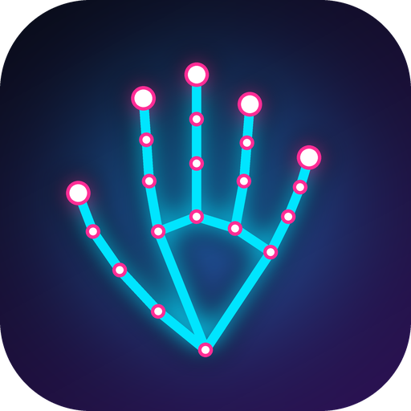

# Air Gestures

Control your Android phone with hand gestures and your voice. The front camera
tracks your hand on the device, and nothing is uploaded.

> A college project built with Kotlin, CameraX and Google MediaPipe.

## Features

| Feature | What it does |
|---|---|
| Hand gestures | Fist (back), pointing, peace, thumbs up/down, pinch, three fingers, L signs and more. Each one is mapped to a phone action. The open palm does nothing by default |
| Customisable | Change what every gesture does in Settings |
| Reel scrolling | Make an L sign (thumb + index) to scroll Instagram Reels up or down |
| Swipe left / right | Point the L sign to the left or right to swipe the screen sideways (photos, stories, pages). Or say "swipe left" |
| Pinch + drag volume | Pinch, then move your hand up or down to set the volume in one smooth stroke. A still pinch mutes |
| Double tap | Hold three fingers to double-tap the screen (likes a reel) |
| System actions | Screenshot, back, recent apps, notifications, flashlight, volume, media keys, lock |
| Voice commands | "Open Spotify", "flashlight on", "what time is it", "tell me a joke" and more |
| Voice Autopilot | "Message Mom saying I'll be late" opens WhatsApp and types it. You say "send" to send. Also "search lofi on YouTube", "click Comment", "type hello" |
| Background mode | A small floating panel shows your hand skeleton while you use other apps |
| Hand-only stage | An animated screen shows just your hand, not your face. Tap to show the camera |
| Battery saver | Pauses the camera when the screen is off |
| Gesture game | A 30-second challenge to practise gestures |
| Practice mode | Tap the small grey line under the gesture pill to see what the AI sees |

## What's new in 2.0

- L sign pointing left or right swipes the screen (photos, stories, pages)
- Voice: "swipe left", "swipe right", "next page", "previous photo", "swipe up/down"
- Pinch + drag sets the volume in one smooth stroke
- New app icon: a neon hand skeleton, with a themed (one-colour) version for Android 13+
- Fist now goes Back, and the open palm does nothing by default
- Fixed: "scroll left" used to scroll down

See [CHANGELOG.md](CHANGELOG.md) for the full history.

## Privacy

- Hand tracking runs **fully on the device**. No images or data leave the phone.
- The **accessibility service** is used to swipe, tap, and (for Voice Autopilot)
  read button labels on the screen. It only looks when you give a voice command
  and never stores or sends what it sees.
- Permissions used: camera, microphone, display over other apps, accessibility,
  and optionally device admin (for the "lock phone" action).

## Install the APK

1. Download `app-release.apk` (or `app-debug.apk`) from the **Releases** page.
2. Open it on your phone. Allow "Install unknown apps" when asked. Play Protect
   may warn about apps outside the Play Store. That is expected.
3. Open Air Gestures and allow camera and microphone.
4. To use reel scrolling, double tap, and Voice Autopilot, enable the
   accessibility service:
   - On Android 13+, first go to **Settings → Apps → Air Gestures → ⋮ → Allow restricted settings**.
   - Then **Settings → Accessibility → Installed apps → Air Gestures → On**.

### "App blocked to protect your device" (Play Protect)?

Google Play Protect can block apps that are installed outside the Play Store and
ask for the accessibility permission. Air Gestures is open source, so you can
read every line of code, but Play Protect cannot tell that. To install it:

1. Open the **Play Store** app and tap your **profile picture**.
2. Tap **Play Protect**, then the **settings** icon (⚙).
3. Turn off **Scan apps with Play Protect**.
4. Install the APK again.
5. Turn Play Protect back on afterwards. The app keeps working.

On some phones the setting is under **Settings → Security and privacy → Google Play Protect**.
If you would rather not change this, build the app yourself (below). That never shows the warning.

## Build from source

1. Install [Android Studio](https://developer.android.com/studio).
2. Clone this repo: `git clone https://github.com/VerFer2521/AirGestures.git`
3. Open the folder in Android Studio and let Gradle sync.
4. Check `app/src/main/assets/gesture_recognizer.task` exists. If it is missing,
   download the MediaPipe Gesture Recognizer model from the
   [MediaPipe docs](https://ai.google.dev/edge/mediapipe/solutions/vision/gesture_recognizer)
   and place it there.
5. Plug in a phone (USB debugging on) and press **Run**.

Requires Android 8.0+ (some features need Android 9 or 11+).

## Built with

- Kotlin, CameraX
- [MediaPipe Tasks Vision](https://ai.google.dev/edge/mediapipe) (Apache 2.0)
- Android AccessibilityService

## Contributing

Issues and pull requests are welcome. Please open an issue first for bigger changes.

## License

MIT. See [LICENSE](LICENSE). MediaPipe and its model are licensed by Google
under Apache 2.0.
